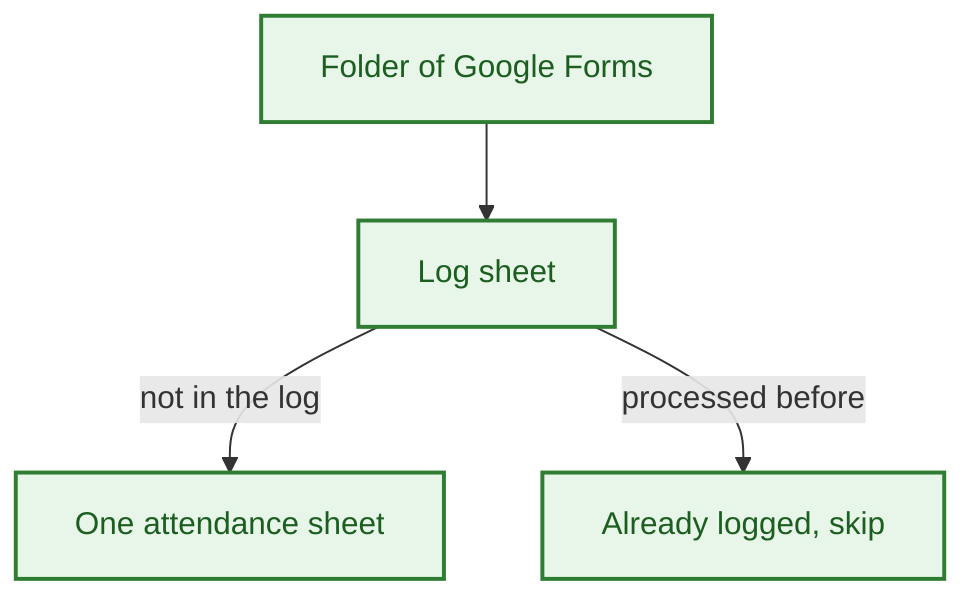
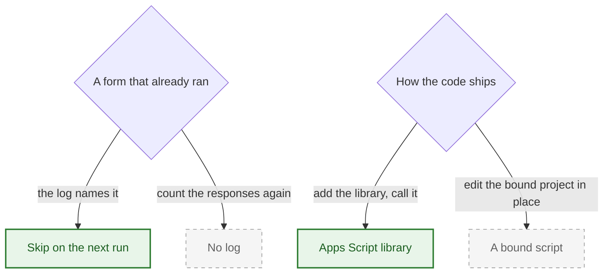

# Attendance Tracker Library – Google Forms to Master Spreadsheet

## Library Links
- [Primary Library](https://script.google.com/macros/library/d/1DyLX-aHpvoPibzjSfcEmZhKRpfo6hpl4EEWZrcQYf0046Gz1COTmhbtK/10)
- [Alternative/Secondary Library](https://script.google.com/macros/library/d/AKfycbzsE8mGxN4txYdxXrHrw-O3KSHJzyMo1fRLYLsBKGIoadwNhDRRjqzXCFB-AWqn9y1I)

This library aggregates attendance data from multiple Google Forms into a single master Google Spreadsheet. It tracks participation counts, prevents duplicate processing, and supports configurable folders.

---

## Features
- Aggregate multiple Google Forms responses into a single sheet.
- Automatically tracks attendance counts per email.
- Prevents double-counting using a log sheet.
- Supports optional folder/subfolder processing.
- Skips RSVP forms automatically (optional).
- Detailed logging for monitoring processing progress.

---

## Installation
1.  Open [Google Apps Script](https://script.google.com/) and create a new project.
2.  Go to **Libraries** → **Add a Library**.
3.  Paste the library ID:
    `AKfycbzsE8mGxN4txYdxXrHrw-O3KSHJzyMo1fRLYLsBKGIoadwNhDRRjqzXCFB-AWqn9y1I`
4.  Select the latest version and click **Add**.
5.  Save your project.

---

## Usage
```javascript
function runAttendanceImport() {
  const summary = importFormsToSpreadsheet({
    parentFolderName: "Class Attendance Forms",
    outputSpreadsheetName: "Master Attendance",
    outputSheetName: "Attendance",
    subfolderName: "Week 1", // optional
    logSheetName: "ProcessedForms", // optional
    skipRSVP: true, // optional
    verbose: true // optional
  });

  console.log("Attendance import complete:", summary);
}

## System design

How a request or a run moves through the code, then the choices behind that shape. In the decision charts, a **solid** box is the route this repo takes and a **dashed** box is the alternative it turns down; the edge label is the tradeoff.

### Folder to one sheet

A spreadsheet script calls the library with a folder, a spreadsheet, and a sheet. The log records a form that already ran. The next run skips it. Counts land on one sheet, per email.



### A log, and a library

The duplicate check is the log of forms, not a hash of each response. The script you bind calls importFormsToSpreadsheet . The library is not a bound script you edit in place.



Longer write-up: [aamogh.vercel.app/projects/attendance-automator](https://aamogh.vercel.app/projects/attendance-automator.html)
